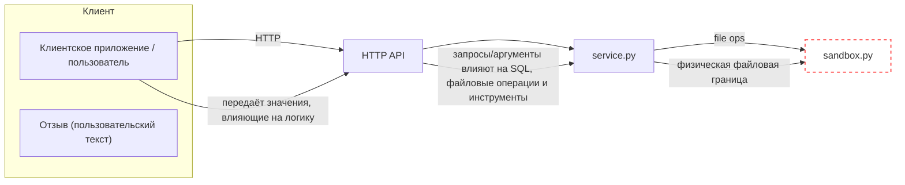
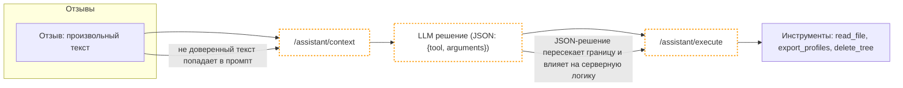

# Модель угроз для Mini Shop

## Актёры и роли

| Роль | Идентификатор/пример | Легитимные права по API (по назначению сервиса) |
|---|---|---|
| Анонимный клиент | без токена | Просмотр состояния (`GET /health`), каталога (`GET /products`). |
| Клиент alice | `alice` (id=1) | Вход (`POST /login`), просмотр собственного профиля и чека, оформление заказа по цене каталога (`POST /orders`), добавление отзывов (`POST /reviews`), получение контекста ассистента по своему заказу (`GET /assistant/context`). |
| Клиент bob | `bob` (id=2) | Аналогично alice для своих данных. |
| Сотрудник магазина | `staff` (id=0) | Экспорт профилей (только для staff) (`GET /admin/export`), просмотр служебных журналов (`GET /debug/logs`) — предполагается ограничение по роли. |
| AI‑помощник (интеграция) | `/assistant/*` | Получение контекста (`GET /assistant/context`), исполнение безопасных инструментов по решению модели в рамках прав клиента (`POST /assistant/execute`). Сервер должен сам контролировать права и проверять аргументы инструментов независимо от решения LLM. |

Примечание: назначение прав сформулировано по README лаборатории и здравому смыслу. Реализация на данный момент может отклоняться — это предмет последующей проверки.

## Диаграмма границ доверия

Отдельно поток ассистента и prompt injection:

## Точки входа (assets & entry points)

Ниже — точки входа из таблицы API. Для каждой указано, что принимает от клиента, какие поля клиент мог бы подделать, и что сервер должен проверять (на этом этапе неизвестно, проверяет ли фактически).

1. `GET /health`
   - Принимает: ничего.
   - Что можно подделать: нет параметров.
   - Что следует проверять: защита от чрезмерного количества запросов (DoS) — базовая операционная защита.

2. `GET /products`
   - Принимает: ничего.
   - Что можно подделать: нет параметров.
   - Что следует проверять: нет бизнес-проверок; операционная защита от DoS.

3. `POST /login` (JSON: `username`, `password`)
   - Принимает: имя пользователя, пароль.
   - Что можно подделать: `username`, `password` (подбор/перебор, перечисление пользователей).
   - Что следует проверять: ограничение попыток (rate limiting), сообщения об ошибках без утечки деталей, хранение и проверка сессии по токену.

4. `GET /profile` (query: `id`)
   - Принимает: идентификатор профиля.
   - Что можно подделать: `id` (выбор чужого профиля; инъекции в запрос к БД при небезопасной интерполяции).
   - Что следует проверять: авторизацию по сессии (доступ только к собственному профилю), параметризованные SQL-запросы, валидацию формата `id`.

5. `GET /search` (query: `q`)
   - Принимает: строку поиска.
   - Что можно подделать: `q` (инъекции; большое значение для нагрузки).
   - Что следует проверять: параметризация SQL, нормализация/ограничение длины, политика видимости результатов (нужно ли ограничивать по роли).

6. `GET /orders`
   - Принимает: ничего.
   - Что можно подделать: —
   - Что следует проверять: авторизацию (возвращать только заказы пользователя), исключать лишние поля, пагинацию.

7. `POST /orders` (JSON: `product`, необязательный `price`)
   - Принимает: товар, опционально цена.
   - Что можно подделать: `product` (несуществующий), `price` (занижение/завышение).
   - Что следует проверять: наличие валидной сессии, что цена берётся из каталога, проверка допустимости товара, защита от манипуляций ценой.

8. `GET /admin/export` (заголовок `X-Role`)
   - Принимает: заголовок роли.
   - Что можно подделать: `X-Role` (спуфинг роли staff).
   - Что следует проверять: роль из серверной сессии, наличие токена, аудит доступа.

9. `GET /files` (query: `user`, `path`)
   - Принимает: имя пользователя и путь в стенде.
   - Что можно подделать: `user`, `path` (доступ к чужим файлам, попытки выхода за пределы, чтение служебных заметок).
   - Что следует проверять: авторизацию на пользователя/ресурс, проверку пути и принадлежности к допустимому набору (sandbox ограничивает физически, но нужна логическая проверка доступа), размер и тип ответа.

10. `POST /reviews` (JSON: `product`, `text`)
   - Принимает: товар и текст отзыва.
   - Что можно подделать: `product` (несуществующий), `text` (вредоносные инструкции, HTML/скрипты).
   - Что следует проверять: допустимость товара, нормализация/экранирование текста, ограничения длины.

11. `GET /reviews/view`
   - Принимает: ничего.
   - Что можно подделать: — (но содержимое формируется из пользовательских отзывов).
   - Что следует проверять: экранирование HTML, политика доступа (нужно ли ограничивать просмотр).

12. `GET /debug/logs`
   - Принимает: ничего.
   - Что можно подделать: — (но журнал может содержать чувствительные заголовки/тела).
   - Что следует проверять: ограничение по роли (staff), маскирование секретов (токены), объём выдачи.

13. `GET /assistant/context` (query: `order_id`, `question`)
   - Принимает: идентификатор заказа, вопрос пользователя.
   - Что можно подделать: `order_id` (чужой заказ), `question` (попытка влияния на модель).
   - Что следует проверять: авторизацию на заказ, нормализация ввода, изоляция от отзывов с вредоносными инструкциями (против prompt injection), контроль формата создаваемого промпта.

14. `POST /assistant/execute` (JSON: `decision: {tool, arguments}`)
   - Принимает: выбор инструмента и аргументы от LLM/клиента.
   - Что можно подделать: `tool` (выбор опасного инструмента), `arguments` (путь к критичным файлам в стенде и т.п.).
   - Что следует проверять: наличие и роль сессии, авторизация на инструмент по роли, строгая валидация аргументов (пути, форматы), защита от выполнения опасных действий вне контекста прав пользователя.

15. `GET /products` и `GET /health` уже учтены в п.1–2 и повторно не перечисляются.

## Потенциальные классы угроз по STRIDE

Отнесение по STRIDE для каждой точки входа — это гипотезы, основанные на текущем описании и исходном коде; фактическая подтверждённость будет проверяться отдельно.

- `POST /login`: Spoofing (подбор/спуфинг учётных данных), Repudiation (отсутствие аудита попыток), DoS (массовые попытки входа).
- `GET /profile`: Tampering (инъекции в запрос), Information Disclosure (чужие профили), Elevation of Privilege (обход авторизации по id), Repudiation (нехватка трассируемости доступа).
- `GET /search`: Tampering (SQL-инъекции), DoS (очень длинные/тяжёлые запросы), Information Disclosure (слишком широкая выдача).
- `GET /orders`: Information Disclosure (чужие заказы), Repudiation (нет связи сессии и запроса).
- `POST /orders`: Tampering (манипуляция ценой), Elevation of Privilege (влияние на бизнес-логику цен), Repudiation (отсутствие строгой привязки к владельцу при создании).
- `GET /admin/export`: Spoofing (подмена `X-Role`), Elevation of Privilege (получение прав staff), Information Disclosure (выгрузка всех профилей), Repudiation (отсутствие корректного аудита роли).
- `GET /files`: Tampering (подмена `user`/`path` для доступа к чужим/служебным файлам), Information Disclosure (чтение секретов из стенда), Elevation of Privilege (обход логических ограничений доступа), DoS (чтение больших файлов).
- `POST /reviews`: Tampering (вредоносный контент в тексте), Repudiation (отсутствие привязки к автору), Elevation of Privilege (влияние на ассистента через prompt injection) — как гипотеза.
- `GET /reviews/view`: Information Disclosure (выдача сырых отзывов), Tampering/DoS (если рендер без экранирования может повлиять на клиента/агента), Repudiation (нет контроля, кто просматривал).
- `GET /debug/logs`: Information Disclosure (утечка заголовков/тел JSON), Spoofing (подмена заголовков в журнале, влияющая на анализ), Repudiation (отсутствие контроля доступа).
- `GET /assistant/context`: Information Disclosure (чужие заказы в контексте), Tampering (влияние на промпт через вопрос), Elevation of Privilege (косвенно через решение модели), Repudiation (нет явной связи сессии и формируемого контекста).
- `POST /assistant/execute`: Elevation of Privilege (исполнение инструментов без/вне прав), Tampering (аргументы инструментов), DoS (массовые операции удаления), Information Disclosure (чтение файлов), Repudiation (отсутствие аудита источника решения).
- `GET /health`, `GET /products`: DoS (массовые запросы) — гипотеза, низкий риск.

## AI‑помощник как вектор атаки

Поток: `/assistant/context` → внешний запуск `shop-planner` (opencode run) → решение модели (JSON) → `/assistant/execute` → исполнение инструмента.

- Точка попадания недоверенного текста: отзыв (`POST /reviews`) добавляет произвольный текст, который попадает в промпт, формируемый `GET /assistant/context`. Вопрос пользователя (`question`) также недоверен.
- Доверие к JSON-решению модели: текущая архитектура предполагает приём `{tool, arguments}` от модели и исполнение соответствующего инструмента на сервере. Сервер не должен полагаться на корректность или добросовестность решения LLM.
- Независимые проверки, которые должны выполняться сервером:
  - Авторизация: наличие действующей сессии и проверка роли перед исполнением любого инструмента.
  - Политики доступов: сопоставление инструмента и прав пользователя (например, `export_profiles` — только для staff; чтение файла — только своего чека и разрешённых путей).
  - Валидация аргументов: строгая проверка `path` в границах стенда и в соответствии с правами, запрет на операции удаления вне разрешённых сценариев.
  - Аудит: логирование источника решения и результата с привязкой к сессии, маскирование секретов.
  - Защита от prompt injection: конструирование контекста так, чтобы инструкции из отзывов не могли расширять полномочия; даже при вредоносном JSON сервер должен отклонять неавторизованные действия.

## Приоритизация (вероятность × импакт)

Ранжирование точек входа как список гипотез к проверке:

1. `POST /assistant/execute` — высокая вероятность некорректного контроля прав и аргументов; потенциальный импакт: чтение/удаление файлов стенда, экспорт данных.
2. `GET /admin/export` — вероятность спуфинга роли через заголовок; импакт: утечка всех профилей.
3. `GET /files` — вероятность обхода логических ограничений доступа по `user`/`path`; импакт: чтение служебных секретов и чужих чеков.
4. `GET /profile` и `GET /search` — вероятность инъекций при интерполяции запросов; импакт: утечки данных и/или изменение данных (если бы были записи).
5. `POST /orders` — вероятность манипуляции ценой через пользовательский `price`; импакт: финансовое влияние на заказы.
6. `GET /assistant/context` — вероятность включения чужих заказов и воздействия отзывов (prompt injection) на контекст; импакт: косвенное влияние на последующие действия ассистента.
7. `GET /orders` — вероятность выдачи чужих заказов; импакт: утечка информации.
8. `GET /debug/logs` — вероятность утечки токенов и тел запросов; импакт: компрометация сессий и приватности.
9. `POST /reviews` / `GET /reviews/view` — вероятность XSS/вредоносного контента и влияния на ассистента; импакт: воздействие на клиентов/агента.
10. `POST /login` — вероятность перебора; импакт: захват учётки при слабой защите.
11. `GET /products`, `GET /health` — низкий приоритет (операционные риски DoS).

Это ранжирование — ориентир для последующих тестов. На этом этапе мы формулируем гипотезы «требует проверки, потому что...», а подтверждённые находки будут вынесены отдельно в REPORT_01 после практических проверок.
